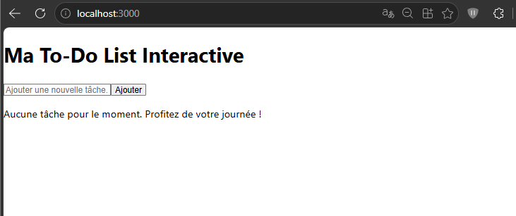
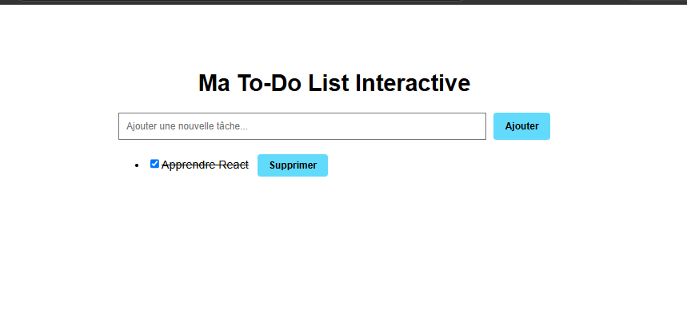
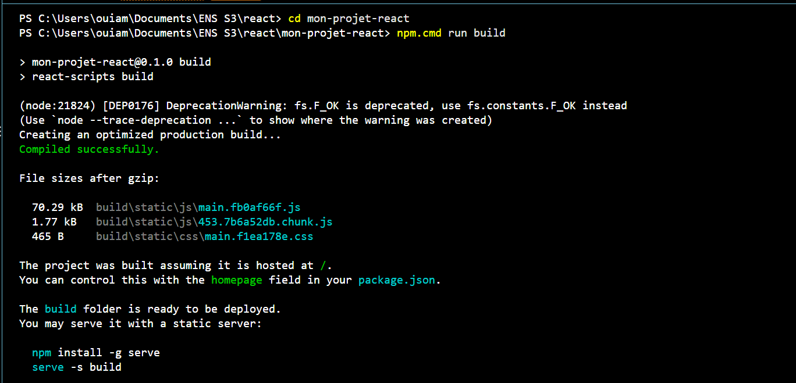

# TP 4 : Projet de synthèse React – To-Do List interactive ou Blog simple

## 1. Objectif du projet

Ce projet consiste à créer une application To-Do List Interactive avec React. Elle permet de gérer une liste de tâches grâce à une interface simple et interactive.

Les objectifs principaux sont :

Créer et organiser des composants React.

Manipuler les données avec le hook useState.

Utiliser les props pour communiquer entre les composants.

Gérer les événements et les formulaires.

Améliorer l'interface avec CSS.

##  2. Structure du projet

Le projet est organisé en plusieurs composants, chacun ayant une responsabilité précise.

## 3. Création des composants

## 3.1. Composant TodoForm

Le composant TodoForm permet à l'utilisateur de saisir une nouvelle tâche et de l'ajouter à la liste.

Le hook useState gère le contenu du champ de saisie. Lors de la soumission du formulaire, la tâche est ajoutée et le champ est vidé. Les champs vides sont ignorés.

## 3.2. Composant TodoList

Le composant TodoList reçoit les tâches via les props et utilise la méthode map() pour afficher chaque tâche avec le composant TodoItem.

Lorsque la liste est vide, un message indique qu'aucune tâche n'est disponible.

## 3.3. Composant TodoItem

Le composant TodoItem affiche une tâche, une case à cocher et un bouton de suppression.

La case à cocher permet de marquer une tâche comme terminée ou en cours.

Une tâche terminée apparaît avec un texte barré.

Le bouton « Supprimer » permet de retirer une tâche de la liste.

4. Gestion de l'état dans App.js

Le composant App centralise la gestion des tâches à l'aide du hook useState.

Trois fonctions principales sont utilisées :

ajouterTache() : ajoute une nouvelle tâche au tableau.

changerEtat() : modifie l'état d'une tâche.

supprimerTache() : supprime une tâche du tableau.

Les données et les fonctions sont transmises aux composants enfants grâce aux props.

## 5. Tests et vérifications

Les principales fonctionnalités de l'application ont été testées :

Ajout d'une nouvelle tâche.

Affichage automatique de la liste.

Modification de l'état d'une tâche.

Suppression d'une tâche.

Vérification du formulaire vide.

## 6. Amélioration du style CSS

Le fichier App.css permet d'améliorer la présentation de l'application.

Le style utilisé permet notamment de :

Centrer le contenu de l'application.

Organiser le formulaire et le champ de saisie.

Personnaliser les boutons.

Ajouter des espacements entre les tâches.

Modifier l'apparence des boutons au survol.

## 7. Préparation de la version de production

7. Préparation de la version de production

Pour préparer l'application au déploiement, la commande suivante a été exécutée :

npm run build

Cette commande a permis de générer le dossier build, qui contient les fichiers optimisés nécessaires à la mise en production.

Les fichiers JavaScript et CSS sont regroupés et optimisés afin de préparer l'application à son hébergement.

Résultat : la compilation s'est terminée avec succès et le dossier build est prêt à être déployé.

Cette étape prépare l'application à la publication, mais ne signifie pas qu'elle a déjà été mise en ligne sur Internet.

